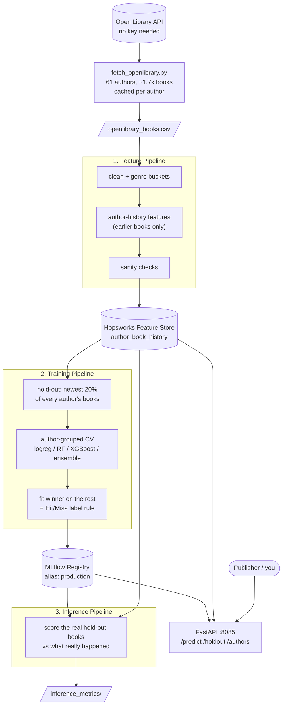

# Novel Success ML Prediction



When Stephen King releases a new electrifying, engrossing horror novel, or when Africa's very own Chimamanda Ngozi Adichie puts out a new body of work that weaves impeccable story-telling with the rich details of African culture,
there's almost no doubt in your mind that you're about to be completely sucked in and glued to the pages, right?

But sometimes (on rare occasions) the works of these great authors fall short; not necessarily judged by the content of the novel, but by the low impressions and reactions they garner from avid readers. That's the 30,000 ft-view of this project:
to build a Machine Learning system that looks at an author's **earlier books and how readers received them**, and predicts whether their **next book** will be a **'Hit'** or a **'Miss'**, so publishing firms can better channel those early post-launch campaign and marketing funds. Being an avid reader from childhood, I started this on the works of authors I've read and re-read, and then widened it to a catalogue of **~1,700 novels by 61 authors** (Jane Austen, H. G. Wells, Tom Clancy, Lee Child, Neil Gaiman, Brandon Sanderson, Colleen Hoover... a proper mix of eras and genres) pulled from the free Open Library API.

This is an end-to-end ML system that follows the principles of ML System Design. Big shoutout to [Paul Bajo](https://x.com/paulabartabajo_), his Twitter page bestowed me with snippets of this knowledge which I pieced together to get this up and running.
So it's a **Feature Pipeline**, a **Training Pipeline**, and an **Inference Pipeline**, running one after the other like clockwork, with a **FastAPI** service on the end of it and **GitHub Actions** watching over the whole thing.

## The one idea everything hangs on

> **"Did this book do as well as this author's books usually do?"**

A publisher can't do much with "Stephen King sells more than a debut author", they already know that. What they *don't* know is whether *this particular* book is going to under-deliver for *this particular* author. So:

- **Features** describe the author's track record *before* the book: how many books they'd published, how well the earlier ones did, how long since the last one, how fast they publish, what genre they usually write, how long this book is compared to their usual.
- **The label** compares the book's reach to that author's own past. A Miss means "well below what this author's earlier books set as the bar" (and not just a book that happens to be read less than King's).
- **Nothing the model sees is allowed to come from after the book launched.** Almost every design choice below is some version of enforcing that.

## Data

**Source:** [Open Library](https://openlibrary.org/developers/api), free, no API key. The fetch script (`fetch_openlibrary.py`) first *discovers* authors through genre searches (thriller, mystery, romance, fantasy, sci-fi, horror, historical, crime, literary, suspense), then pulls **each author's whole catalogue**, one request per author, and caches every response so re-running is free and resumable.

A "book" here is an Open Library *work* (all editions already merged), which means no reprint duplicates. I kept only usable books:

- English, **solo-authored** (co-written books muddy whose audience it is), with a first-publish year,
- at least a handful of readers who shelved it (otherwise there's no popularity signal at all),
- not an obvious non-novel (study guides, box sets, journals, anthologies, screenplays...), and not a record that's just titled with the author's own name,
- near-duplicate titles collapsed (so "Pride & Prejudice" and "Pride and Prejudice" are one book, not two),
- authors with **5 to 60 usable books**: enough for there to be a history to learn from, but few enough that one series factory doesn't swallow the dataset.

**How I measure "success":** `readinglog_count`, the number of Open Library readers who put the book on a shelf (want to read / currently reading / already read). I looked at `ratings_count` first but its median was single digits, far too sparse. Reading-log counts are a *reach* signal, not a *quality* one, and I'm upfront about that in the tradeoffs below.

## Feature Pipeline

`src/features/feature_pipeline.py` takes the raw CSV and turns it into one row per book, then ships it to **Hopsworks' Feature Store** to be stored and versioned.

**What it builds (23 features):**

| Group | Features |
|---|---|
| Track record (from *earlier* books only) | number of earlier books, mean / median / max log-reach, last book's reach, mean of the last three |
| Cadence | years since the last book, career length so far, average years between books |
| This book vs the author's habits | page count, pages relative to the author's usual, share of the author's books in this genre |
| Context | publication year, genre (10 buckets, one-hot) |

Genre comes from Open Library's free-text subject tags, mapped to 10 buckets. The strict rule is in `author_history.compute_history`: a book's features use **only books published in strictly earlier years**, so a book never sees its own outcome, and neither do two books released the same year see each other. The same function builds features in the pipeline, at inference time and inside the API, and a test checks they stay identical (no train/serve skew).

**Leaks I found and killed:** this is the part I'm proudest of, because the metrics looked *great* before I did.
- **Tag sparsity is a popularity proxy.** Famous books get lots of subject tags; obscure ones get few. A book with nothing to say about its genre (the "other" bucket) was a Miss 77% of the time. The model was learning "how popular is this book" from how many tags it had. Fix: an unknown-genre book inherits its author's most common named genre.
- **Edition-derived fields** (`edition_count`, later publishers) only exist *because* a book did well. They're kept in the table as outcomes but are never model inputs.
- Adaptations and an author's *current* fame are circular for the same reason, so they're out too.

I found these with an ablation script (drop a feature group, see what the score does) after one run produced a suspiciously good number. A too-good result is the cue to go hunting, not to celebrate.

**Data-quality checks:** a small set of strict pandas checks (no duplicate `book_id`, no missing values in required columns, no negative counts, sane years, complete features on every trainable row) fails the pipeline loudly instead of letting bad rows through. A local copy `features_local.csv` is saved first so a network failure never costs me the data.

**The store itself:** feature group `author_book_history`, primary key `book_id`, uploaded via the Kafka path (`stream=True`) and waiting until the write has materialised. *All* books go in, including each author's first few that can't be trained on, because inference needs the full catalogue to compute history.

## Training Pipeline

`src/features/train_pipeline.py` pulls the features from Hopsworks and does three things carefully.

**1. A real hold-out, not a random split.** The **newest ~20% of every author's books are set aside before anything else** and never used for fitting, selecting or scaling. That's the honest test of what I actually care about: *an author the model already knows, with a book it has never seen.* (And newest-last is realistic: in real life you predict the book that comes *next*.)

**2. The Hit/Miss label.** For each book: `log10(1 + readers) − the author's median log-reach on earlier books`. A book is a **Miss** only if **both** are true:
- its score is in the bottom 30% of the *training* set, **and**
- its own reach is below the typical book's reach in the training set.

The second condition stops a famous book being called a Miss just because its author's other books were even bigger. The cut-offs are learned on training rows only and **saved with the model**, so held-out and live predictions are labelled with the same ruler, never one re-derived from their own batch.

**3. Model selection that doesn't fool itself.** Four candidates are compared with **author-grouped, repeated K-fold CV** (5 folds x 3 repeats = 15 fits), so all of an author's books land on the same side of each split:

| Candidate | Why it's in the lineup |
|---|---|
| Logistic regression (L2, CV-tuned) | The baseline: fast, interpretable, hard to overfit |
| Random forest | Handles non-linear patterns and feature interactions with almost no tuning |
| XGBoost | The usual winner on tabular data of this size |
| Soft-voting ensemble (logreg + RF + XGBoost) | Averages out each model's blind spots |

A more complex model only wins if it beats the best simpler one by at least **0.01 macro-F1**. If the gain is within noise, the simpler model is the one that ships. The winner is refit on the training part only, scored on the hold-out, and logged to **MLflow** (params, metrics, scaler, label rule, feature list, the confusion matrix, and the exact IDs of the held-out books) and promoted to the `production` alias in the model registry.

## Inference Pipeline

`src/features/inference_pipeline.py` loads the `production` model from MLflow and the full catalogue from Hopsworks, then scores **exactly the books the model never saw**: the held-out ones, whose IDs were saved with the model. It builds each book's features from the author's *earlier* books alone, predicts Hit/Miss, and only afterwards attaches what *really* happened to check the call. No made-up example rows, no synthetic data.

It prints the overall numbers, a "was it actually useful?" check (below), and a per-author table. Books by authors with fewer than two earlier books are reported as skipped, never guessed at.

## FastAPI

The API runs on port **8085** (mapped from 8000 inside the container). Open `http://localhost:8085/docs` and:

| Endpoint | What it does |
|---|---|
| `POST /predict/` | `author_key` + planned publication year (+ optional page count and genre) in, Hit/Miss + probability out, along with every feature value used |
| `GET /holdout` | the real held-out books: prediction next to what actually happened |
| `GET /authors/{key}` | is this author in the catalogue, and how many books do we know? |
| `POST /reload` | pick up a newly promoted model and fresh catalogue without a restart |
| `GET /health` | model version and readiness |

Only what a publisher knows **before launch** is accepted as input. Leave out the page count or genre and the author's usual ones are used. A planned year more than **5 years ahead** is refused with a 422 (nobody can predict 100 years out, lol). An author with too little history gets a clear "can't score" message instead of a made-up answer.

## Results

Scored on the **real hold-out**: 333 books by 61 authors, each book newer than anything the model trained on for that author.

| Metric | Result | For context |
|---|---|---|
| Accuracy | **0.613** | always guessing "Hit" gets 0.565 |
| ROC AUC | **0.678** | 0.5 = coin flip |
| Miss F1 | 0.303 | |
| Of the 20% of books rated **most likely to Miss**... | **69%** really were Misses | 44% if I'd picked at random |
| Of the 20% of books rated **most likely to Hit**... | **78%** really were Hits | 56% if I'd picked at random |

The honest reading: predicting the *exact* label of one book is hard and the model is only modestly better than the "always Hit" baseline. **Where it genuinely earns its keep is ranking.** If a publisher can only afford to push 20% of their list harder, the books the model flags as likely Misses are Misses roughly 7 times out of 10, versus 4 out of 10 by chance. That's the use case this was built for: *where should the early marketing money go?*

It also swings by author. Some careers it reads well (Philip K. Dick 9 of 10, Lee Child 7 of 8, Edgar Wallace 4 of 4) and others it doesn't (Robert Heinlein and John Grisham 4 of 11 each). Authors with a steady track record are easier; erratic ones aren't.

## Design considerations

- **Predict relative to the author, not in absolute terms.** "Is it a hit?" has a trivial answer (big names win). "Does it beat this author's own bar?" is the question a marketing team can actually act on.
- **Guard the time arrow everywhere.** Strictly-earlier history, hold-out by newest books, label cut-offs fit on training only and saved, outcome columns kept out of the inputs. One test checks features never move when a book's own or later outcomes change. A second checks the held-out books were never trained on and their predictions don't depend on their own outcomes.
- **Group the cross-validation by author.** Otherwise the same author appears on both sides of a split and the score is inflated.
- **Simple models first.** On ~1,500 trainable rows of tabular data, a logistic regression is a serious contender and gradient boosting isn't a given. The 0.01 macro-F1 rule makes complexity earn its place. I didn't reach for deep learning because the signal here is a dozen well-chosen numbers, not pixels or sentences.
- **One feature function, three places.** Pipeline, inference and API share `compute_history`, so train/serve skew has nowhere to hide.
- **Hopsworks plays the part of the data version control.** The feature store gives me versioned, queryable features (`author_book_history` v3), so I don't need a separate tool to version a CSV. The raw API responses are cached per author, which does the "reproduce my exact data" job cheaply.
- **Fail loudly.** The feature checks, the missing-model errors, the skipped-books report: I'd rather get an error than a silently wrong number.

## Tradeoffs and what I didn't cover

- **Reach is not quality.** Reading-log counts measure how many people shelved a book *today*. Older books have had longer to collect readers, so publication year is a feature to soften that, not remove it. A recent book can be a "Miss" partly because it's recent.
- **No sales, ratings or marketing data.** Open Library's ratings are too sparse, and real sales figures aren't public. So "Hit" really means "shelved a lot relative to the author's norm".
- **Survivorship in the catalogue.** I only keep authors with at least 5 usable books, which skews toward established authors. **Debut authors can't be scored at all** (no history), which is the cold-start problem and a real limitation for a publisher.
- **Solo-authored, English only, series ignored.** I dropped co-written books, and I didn't model series (a sequel inherits an audience, so it behaves differently). A series flag and "book number in the series" would be a natural next feature.
- **No text or cover signal.** Blurbs, titles and covers (via embeddings) could add real signal. I held back on it because it adds a lot of weight for unproven gain on a dataset this size.
- **The threshold is a choice.** "Bottom 30%" is a judgement call, and moving it shifts the Hit/Miss balance. I'd rather expose it in one config line than pretend it's a law of nature.
- **No hyperparameter search, no probability calibration, no drift monitoring.** Defaults were enough to show the design works; a production system would tune, calibrate the probabilities, and watch for the catalogue changing under it.
- **The registry in Docker is disposable.** MLflow in Compose runs on a local SQLite store, which is great for a portfolio and wrong for a team. A shared tracking server and a real deployment target (the "CD" in CI/CD) are the obvious next steps.
- **Small data for the number of authors.** ~1,700 rows over 61 authors means per-author results are noisy (see the 9/10 versus 4/11 spread above), and I treat the headline numbers as indicative, not final.

## Docker

All the pipelines share **one image** (`Dockerfile.hops`), and **Docker Compose** orchestrates them:

`feature_pipeline` -> `training_pipeline` -> `inference`, with **MLflow** (pinned to the same version as the client) up first, and **FastAPI** starting once training has registered a model. Each stage waits for the one before it to finish *successfully*. The feature pipeline also leaves a small "I wrote N rows" note that training checks, so it never reads a half-synced feature store. Hopsworks' dependencies used to clash with my other requirements, so they live in `requirements_hops.txt` and install separately; `xgboost-cpu` keeps the image from pulling a 350 MB GPU library nobody needs.

```
docker compose up --build
# then open http://localhost:8085/docs
```

## CI-CD

A GitHub Actions workflow has two jobs:
- **test**: on every push and pull request, runs `pytest` (the two tests that guard the project's most important guarantees) and checks the Docker image builds.
- **pipeline**: on pushes to `dev_branch` only (it needs the real Hopsworks secret), runs every stage end to end in Docker, then smoke-tests the live API: `/health`, `/holdout`, a real `/predict/`, and that a year 6 years out is refused.

## Project structure

```
.
├── api/fast_api.py                 FastAPI service
├── src/
│   ├── config.py                   one place for settings, columns, thresholds
│   └── features/
│       ├── fetch_openlibrary.py    discover authors + fetch catalogues (cached)
│       ├── feature_pipeline.py     features -> Hopsworks
│       ├── author_history.py       the strictly-earlier-books feature function
│       ├── genre.py                subject tags -> 10 genre buckets
│       ├── labeling.py             Hit/Miss rule (fit on train, saved with the model)
│       ├── train_pipeline.py       hold-out, grouped CV, model selection, MLflow
│       ├── model_registry.py       promote / load the production model
│       ├── inference_pipeline.py   score the real hold-out books
│       ├── evaluation.py           accuracy, F1, AUC, "how useful is the ranking"
│       └── hopsworks_utils.py      feature store login
├── test/test_core.py               the two tests that matter most
├── data/openlibrary_books.csv      the fetched catalogue
├── docker-compose.yaml  Dockerfile.hops
├── requirements.txt  requirements_hops.txt  requirements-dev.txt
└── .github/workflows/ci-cd.yaml
```

## Run it yourself

1. Put `HOPSWORKS_API_KEY` in a `.env` file (never commit it) and add your contact email as `OPENLIBRARY_CONTACT` if you want to run the fetch.
2. `python src/features/fetch_openlibrary.py` to build the dataset (optional, `data/openlibrary_books.csv` is included).
3. `docker compose up --build` runs everything, or run `feature_pipeline.py`, `train_pipeline.py` and `inference_pipeline.py` from `src/features/` in order with an MLflow server running.
4. `pytest` for the tests.
